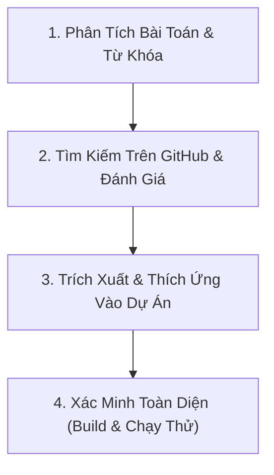

# GitHub Code & Skill Curator (Khai Thác Mã Nguồn & Skill GitHub Chuẩn Xác)

Skill này cung cấp quy trình chuẩn hóa giúp agent và lập trình viên luôn **nghiên cứu, chắt lọc và dựa vào các mã nguồn / skill / thư viện xuất sắc nhất trên GitHub** để xây dựng dự án **PTUD_NuoiThu** (Web & Desktop Virtual Pet Productivity Platform) đạt chất lượng cao nhất, tối ưu hiệu năng và không lỗi.

---

## 🎯 1. Nguyên Tắc Cốt Lõi: "Dựa Vào Chuẩn Mực GitHub"

Mỗi khi nhận một yêu cầu phát triển hoặc giải quyết vấn đề kỹ thuật:
1. **Không phỏng đoán hoặc tự chế giải pháp tạm bợ (No fragile hacks):** Luôn tìm kiếm giải pháp hoặc mẫu kiến trúc đã được cộng đồng GitHub kiểm chứng (battle-tested) cho bài toán tương tự.
2. **Khớp nối chuẩn xác với Tech Stack của Dự Án:**
   * **Frontend:** React 18, Vite, TypeScript, Tailwind CSS, HTML5 Canvas 2D (Pixel-art Nearest Neighbor), Lucide React.
   * **Desktop App:** Electron (Multi-window, Transparent frameless window, click-through `setIgnoreMouseEvents`, 2-way IPC bridge, Global Shortcuts).
   * **Backend:** Node.js, Express, TypeScript, Prisma ORM, SQLite / PostgreSQL, JWT Auth, RESTful API.
   * **AI & Media:** Gemini API, Groq Whisper STT, Web Audio API / VAD, YouTube iFrame API, Edge-TTS.
3. **Chắt lọc & Thích ứng (Adaptation, not blind copy):** Chỉ kế thừa tư tưởng kiến trúc, thuật toán và mẫu thiết kế sạch; tái cấu trúc cho tương thích hoàn toàn với mã nguồn hiện hữu của dự án.
4. **Kiểm tra nghiêm ngặt (Zero Errors):** Mọi mã nguồn tích hợp phải build sạch 0 lỗi TypeScript (`npm run build`), bảo toàn tài liệu và tính tương thích ngược.

---

## 🔄 2. Quy Trình 4 Bước Triển Khai (Standard Operating Procedure)



### Bước 1: Phân Tích Bài Toán & Xác Định Từ Khóa GitHub

Khi đối mặt với một tính năng (ví dụ: animation state machine, transparent overlay, sound visualizer, Pomodoro timer state, pixel sprite slicing):
1. Tách nhỏ bài toán thành các khối kỹ thuật cốt lõi (Core Technical Modules).
2. Định dạng câu truy vấn tìm kiếm GitHub hiệu quả:
   * **Tìm kiếm Repository:** `"<từ khóa>" language:TypeScript stars:>100` hoặc `topic:<chủ đề>`
   * **Tìm kiếm qua Web Search:** `site:github.com <chủ đề> <ngôn ngữ>` (ví dụ: `site:github.com electron transparent desktop pet typescript`, `site:github.com react pixel art canvas sprite animation`)
   * **Tìm kiếm Thư viện npm:** `<tên bài toán> "npm package" github`

### Bước 2: Bộ Tiêu Chí Đánh Giá Mã Nguồn (Vetting Matrix)

Trước khi đưa bất kỳ mẫu mã nguồn hoặc thư viện nào vào dự án, phải chấm điểm qua 5 tiêu chí:

| Tiêu Chí | Yêu Cầu Tối Thiểu | Đánh Giá Tốt |
| :--- | :--- | :--- |
| **Ngôn ngữ & Kiểu dữ liệu** | Có TypeScript Type Definitions | Viết 100% bằng TypeScript |
| **Bảo trì & Tương thích** | Hoạt động tốt với Node 18+ và React 18+ | Cập nhật gần đây, không deprecated |
| **Giấy phép (License)** | MIT, Apache 2.0, BSD, ISC | Không dùng GPL v3 cho các module độc quyền |
| **Độ gọn nhẹ (Footprint)** | Không kéo theo dependency cồng kềnh | Tree-shakeable, Zero hoặc ít dependencies |
| **Độ ổn định kiến trúc** | Xử lý triệt để memory leak, resize, timer cleanup | Có test coverage, tài liệu rõ ràng |

### Bước 3: Thích Ứng & Tích Hợp Vào Dự Án (Architectural Adaptation)

1. **Chuẩn hóa cấu trúc:** Đặt mã nguồn vào đúng vị trí:
   * **Component UI:** `frontend/src/components/`
   * **Dịch vụ API / Client:** `frontend/src/services/`
   * **Electron Main / Preload:** `frontend/electron/`
   * **Backend Route / Controller:** `backend/src/routes/`
   * **Backend Service / Business Logic:** `backend/src/services/`
2. **Loại bỏ mã thừa:** Chỉ giữ lại đúng phần xử lý cốt lõi, xóa bỏ các phụ thuộc không liên quan.
3. **Đồng bộ State & IPC 2 chiều:** Đảm bảo mọi cập nhật giữa Desktop Overlay (`DesktopPetWindow.tsx`), Cửa sổ chính (`App.tsx`) và Backend API luôn đồng bộ qua IPC `window.officePet`.

### Bước 4: Kiểm Chứng & Xác Minh

* **Biên dịch Frontend:** `npm --prefix frontend run build` (Bắt buộc exit code 0).
* **Biên dịch Backend:** `npm --prefix backend run build` (Bắt buộc exit code 0).
* **Kiểm tra tương thích đa môi trường:** Cả trên trình duyệt Web (Localhost / PiP) và Desktop Window (Electron frameless transparent).

---

## 📚 3. Danh Mục Tham Chiếu Mã Nguồn GitHub Mẫu Theo Domain

Khi làm việc với các thành phần của **PTUD_NuoiThu**, tham chiếu ngay các dự án mẫu tiêu biểu sau:

### 1. Desktop Pet & Screen Overlay (Electron Transparent Window)
* **Bài toán:** Cửa sổ trong suốt, click-through khi di chuyển, luôn nổi trên các ứng dụng, đồng bộ IPC mượt mà.
* **Tham chiếu tiêu biểu trên GitHub:**
  * `desktop-cat` / `screen-pet` / `vpet`: Quản lý transparent BrowserWindow, frameless window, `setIgnoreMouseEvents({ forward: true })`.
  * `electron-overlay`: Kỹ thuật neo tọa độ màn hình (WorkArea), bắt sự kiện di chuột và kéo thả không giật lag.

### 2. Pixel Art Canvas & Sprite Sheet Rendering
* **Bài toán:** Vẽ sprite sheet 2D không bị mờ (pixelated), quản lý fps và frame loops, crop theo ô hàng/cột chuẩn xác, tự động fallback state.
* **Tham chiếu tiêu biểu trên GitHub:**
  * `crisp-game-lib` / `pixel-canvas`: Thiết lập canvas `imageSmoothingEnabled = false`, tính toán toạ độ `sx, sy` theo `globalFrameIdx % totalColumns`.
  * `aseprite-sheet-viewer`: Xử lý one-shot vs continuous looping animation states.

### 3. Pomodoro Timer & Gamification State Machine
* **Bài toán:** Bộ đếm thời gian tập trung chính xác (Web Worker / delta time), thưởng phạt EXP, âm thanh báo chuông, chống trôi thời gian khi tab bị ẩn.
* **Tham chiếu tiêu biểu trên GitHub:**
  * `pomodoro-timer-react`: Sử dụng `performance.now()` hoặc Web Worker để timer chạy đúng từng mili-giây kể cả khi nền bị throttle.
  * `gamified-habits`: Công thức tính EXP cấp độ, tank chứa kinh nghiệm và chuỗi nhiệm vụ ngày (daily quests).

### 4. Audio, Voice & Music Stream
* **Bài toán:** Phát nhạc nền (BGM), phát YouTube âm thầm không quảng cáo, nhận diện giọng nói (STT) và đọc văn bản (TTS).
* **Tham chiếu tiêu biểu trên GitHub:**
  * `react-youtube` / `custom-audio-player`: Quản lý lifecycle phát nhạc, âm lượng mượt (fade-in / fade-out), playlist shuffle/loop.
  * `voice-activity-detection` (VAD): Xử lý ngưỡng âm thanh (silence timeout, speech threshold) trước khi gửi stream tới Whisper/Gemini.

---

## 🛠️ 4. Công Cụ Hỗ Trợ Tìm Kiếm (Scripts & Helpers)

Trong thư mục `scripts/` của skill này có sẵn script hỗ trợ tìm kiếm nhanh:
* [search_github.py](./scripts/search_github.py): Tìm kiếm các repository hoặc code mẫu trên GitHub theo từ khóa, ngôn ngữ và bộ lọc sao.

Để chạy script tìm kiếm nhanh:
```powershell
python ".agents/skills/github-code-and-skill-curator/scripts/search_github.py" --query "electron transparent pet" --lang "typescript" --min-stars 50
```

---

## 📌 5. Checklist Trước Khi Hoàn Tất Bất Kỳ Tác Vụ Nào

- [ ] Đã tra cứu giải pháp hoặc kiến trúc chuẩn trên GitHub/npm trước khi viết code?
- [ ] Giải pháp có tương thích với React 18, Vite, Electron và Prisma của dự án không?
- [ ] Đã dọn dẹp các side-effects (`clearTimeout`, `clearInterval`, `removeEventListener`, `ipcRenderer.removeAllListeners`) để chống memory leak?
- [ ] Chạy `npm --prefix frontend run build` đạt 0 lỗi TypeScript?
- [ ] Đã kiểm tra hoạt động ổn định trên cả Web và Desktop App?
